# 碳排放趋势预测——模型评测与 2026 年预测报告

**数据范围**：2019-01—2025-12（84 个月 × 3 个分公司）
**评测协议**：2019—2024 训练、2024 验证选参、2025 留出测试；2019—2025 重训后预测 2026
**随机种子**：20260928
**预测情景**：BAU（基准）

---

## 1. 数据概况

| 项目     | 数值                         |
| ------ | --------------------------:|
| 组织数    | 3（机辆、肃宁、原平）                |
| 月度排放记录 | 252                        |
| 活动数据记录 | 2,100                      |
| 外部因子记录 | 2,244                      |
| 严重异常   | 19（机辆 8、肃宁 6、原平 5）         |
| 冠军模型   | 机辆 SW-LSTM；肃宁 Ridge；原平 GBM |

### 1.1 口径还原

- 电力因子：2019—2021 0.8843；2022 0.5703；2023 0.5568；2024 0.5366；2025 0.5306。
- 供热系数：肃宁 2024 前 0.9224、2025 0.380；原平 2024 前 0.9224、2025 0.334。
- 建模目标：`CO2_COMPARABLE_NONDIESEL` = 可比总排放 − 柴油排放。
- 预测输出：`comparable_point`（可比口径）与 `reported_point`（报表口径）。

### 1.2 年度实际（tCO2e）

| 组织  | 口径  | 2019      | 2020      | 2021      | 2022      | 2023      | 2024    | 2025    |
| --- | --- | ---------:| ---------:| ---------:| ---------:| ---------:| -------:| -------:|
| 机辆  | 报表  | 1,457,258 | 1,512,819 | 1,575,746 | 1,050,422 | 1,053,507 | 956,459 | 941,131 |
| 机辆  | 可比  | 893,083   | 937,238   | 976,437   | 982,189   | 1,007,323 | 946,538 | 941,131 |
| 肃宁  | 报表  | 42,296    | 38,397    | 49,224    | 25,792    | 24,019    | 24,835  | 22,913  |
| 肃宁  | 可比  | 28,495    | 25,938    | 32,335    | 24,509    | 23,286    | 24,660  | 25,934  |
| 原平  | 报表  | 32,673    | 37,704    | 36,004    | 30,210    | 30,682    | 30,595  | 16,699  |
| 原平  | 可比  | 26,267    | 29,452    | 28,433    | 29,429    | 30,209    | 30,485  | 28,652  |

> 报表口径的“断崖”主要来自因子/供热系数切换，不代表实际减排。可比口径才是趋势分析的依据。

---

## 2. 灰色关联分析（GRA）

**方法**：初值化（零膨胀序列用极差化）、ρ=0.5、ρ∈{0.1,0.3,0.5,0.7,0.9} 敏感性、一阶差分去趋势、|Pearson|>0.85 共线剔除、入选上限 `floor(N/20)`。

| 组织  | 排名  | 因子         | r     | r_detrend | 入选  | 说明              |
| --- | ---:| ---------- | -----:| ---------:|:---:| --------------- |
| 机辆  | 1   | 全国火力发电量    | 0.705 | 0.670     | ✔   | 略高于阈值，边界变量      |
| 机辆  | 2   | 全国铁路货运量    | 0.692 | 0.688     |     | 阈值边界            |
| 机辆  | 3   | 秦皇岛港动力煤长协价 | 0.616 | 0.632     |     | 未达阈值            |
| 机辆  | 4   | 采暖度日       | 0.586 | 0.673     |     | 零膨胀，极差化         |
| 机辆  | 5   | 政策事件强度     | 0.563 | 0.509     |     | 仅解释用            |
| 机辆  | 6   | 三省原煤产量合计   | 0.518 | 0.755     |     | 未达阈值            |
| 肃宁  | 1   | 采暖度日       | 0.651 | 0.658     | ✔   | 无变量达 0.70，G3 兜底 |
| 肃宁  | 2   | 政策事件强度     | 0.515 | 0.487     | ✔   | 兜底              |
| 肃宁  | 3   | 全国火力发电量    | 0.510 | 0.701     | ✔   | 兜底              |
| 肃宁  | 4   | 全国铁路货运量    | 0.507 | 0.752     | ✔   | 兜底              |
| 肃宁  | 5   | 秦皇岛港动力煤长协价 | 0.489 | 0.639     |     | 未达阈值            |
| 肃宁  | 6   | 三省原煤产量合计   | 0.460 | 0.739     |     | 未达阈值            |
| 原平  | 1   | 采暖度日       | 0.803 | 0.785     | ✔   | 唯一稳定强关联         |
| 原平  | 2   | 政策事件强度     | 0.580 | 0.599     |     | 未达阈值            |
| 原平  | 3   | 全国火力发电量    | 0.552 | 0.588     |     | 未达阈值            |
| 原平  | 4   | 全国铁路货运量    | 0.536 | 0.663     |     | 未达阈值            |
| 原平  | 5   | 秦皇岛港动力煤长协价 | 0.515 | 0.717     |     | 未达阈值            |
| 原平  | 6   | 三省原煤产量合计   | 0.476 | 0.698     |     | 未达阈值            |

**结论**：

1. 只有原平 HDD、机辆火电略高于阈值；煤价、煤产量、铁路货运量整体未通过筛选。
2. 肃宁无变量达阈值，按方案 G3 兜底取前 4，必须在报告中标注“专家兜底”，不能表述为“关键驱动因素”。
3. GRA 是趋势相似度，不是因果、贡献率或弹性；本报告不使用“煤价导致排放”等措辞。
4. 因 CDD 在原平全 0、在其他组织强零膨胀，已从主筛选中剔除，避免伪高关联。

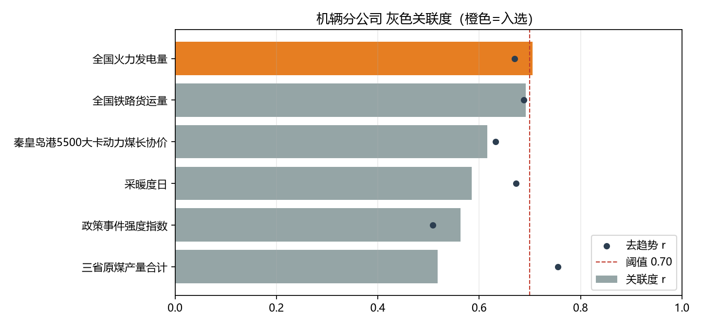
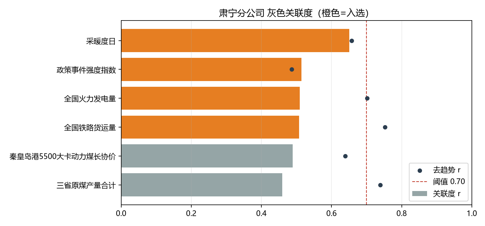
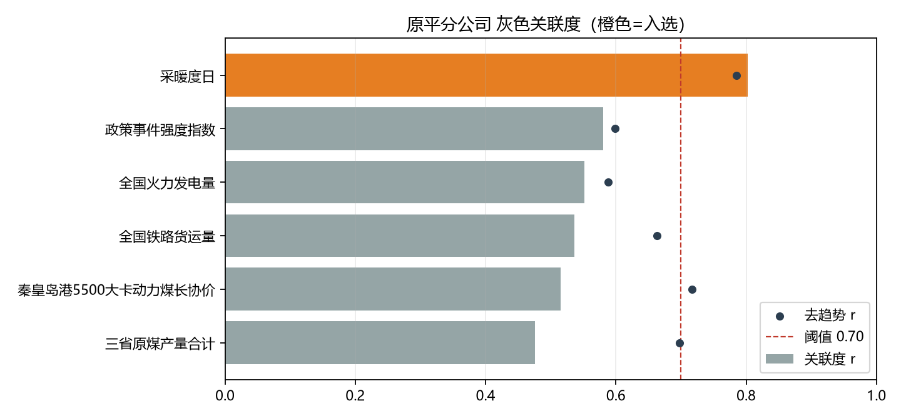

---

## 3. 模型选择与 2025 留出测试

### 3.1 选择规则

- 候选：SW-LSTM（W∈{6,9,12}，hidden∈{32,64}）、Ridge、GBM、Holt-Winters、Seasonal Naive；
- 多折滚动验证：训练截至 2021/2022/2023，分别验证 2022/2023/2024；
- 以三折平均 MASE 为主指标；
- 若 SW-LSTM 与最优模型差距 ≤10%，优先 SW-LSTM（方案主算法）；
- 年度展望在 LSTM 最优 2% 误差带内优先较大 W（完整年周期）。

### 3.2 冠军模型

| 组织  | 冠军      | W   | 隐藏层 | 2025 MASE | 2025 MAPE | 2025 RMSE | 2025 R² | 2025 Bias |
| --- | ------- | ---:| ---:| ---------:| ---------:| ---------:| -------:| ---------:|
| 机辆  | SW-LSTM | 12  | 32  | 1.0906    | 9.75%     | 9,473     | -0.9401 | +65       |
| 肃宁  | Ridge   | 6   | —   | 0.4822    | 10.56%    | 265       | 0.9207  | -54       |
| 原平  | GBM     | 6   | —   | 0.6393    | 8.15%     | 298       | 0.9714  | +83       |

> 评测口径说明：总排放 = 非柴油模型预测 + 2025 年实际柴油。这样可单独评估 LSTM/Ridge/GBM 对非柴油部分的精度；运营期柴油由独立模块按台数计划预测。按 2024 年均 30.25 台→2025 年 16 台推算，2025 柴油预测约 9,909 t，实际 9,529 t，误差约 4%，对总排放影响约 0.13%。

**解读**：

- 机辆 MASE=1.09，仅略优于季节 naive（1.40），说明 12 个月直接多步在结构断点年仍很难；但 Bias≈+65，几乎无系统性偏移。
- 肃宁/原平 MASE<1，显著优于季节 naive；R² 高，说明热力/供暖季节规律可被模型捕捉。
- 机辆 R² 为负，是因为 2025 年排放水平与 2023—2024 年接近但波动结构变化，R² 对水平偏移敏感；MASE/MAPE 更能反映实际可用性。

### 3.3 2025 测试集基线对比（MASE）

| 模型             | 机辆         | 肃宁         | 原平         |
| -------------- | ----------:| ----------:| ----------:|
| SW-LSTM        | **1.0906** | 0.6943     | 0.9635     |
| Ridge          | 1.1533     | **0.4822** | 0.9959     |
| GBM            | 1.3419     | 0.3814     | **0.6393** |
| Holt-Winters   | 11.0653    | 4.5767     | 7.3979     |
| Seasonal Naive | 1.4028     | 0.5456     | 0.8557     |

> 肃宁 GBM 的 2025 测试 MASE=0.381 优于 Ridge 0.482，但 GBM 在 2024 折的验证 MASE 更高、跨折方差更大；按“多折平均 MASE”选 Ridge。若更看重单年精度，可在平台配置中切换 GBM 为冠军。

### 3.4 滚动回测（冠军配置，MASE）

| 组织  | 验证 2022 | 验证 2023 | 验证 2024 | 均值    |
| --- | -------:| -------:| -------:| -----:|
| 机辆  | 0.699   | 0.817   | 0.835   | 0.784 |
| 肃宁  | 0.960   | 0.439   | 0.411   | 0.603 |
| 原平  | 0.781   | 0.592   | 0.902   | 0.758 |

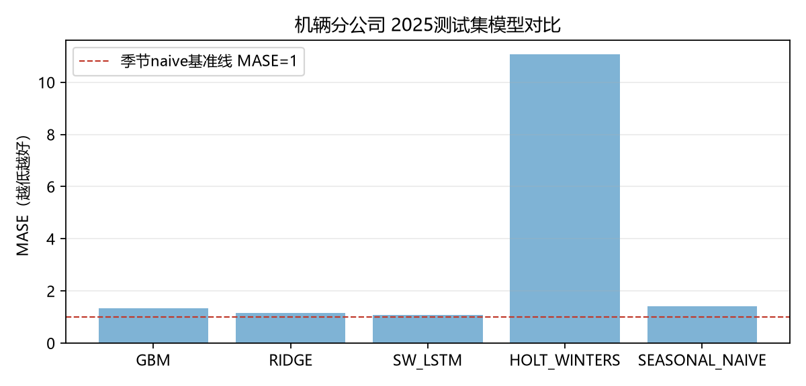
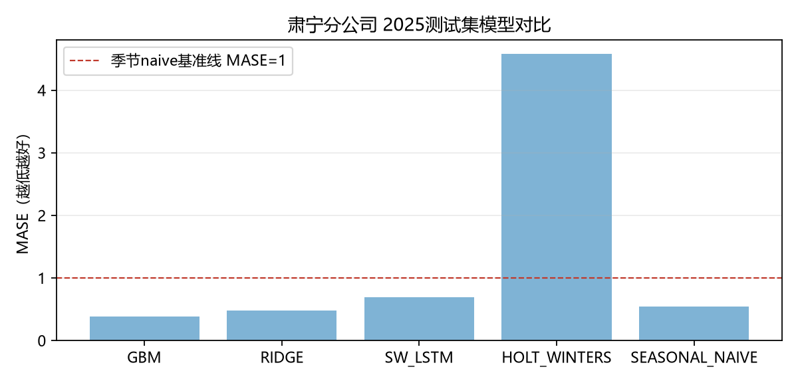
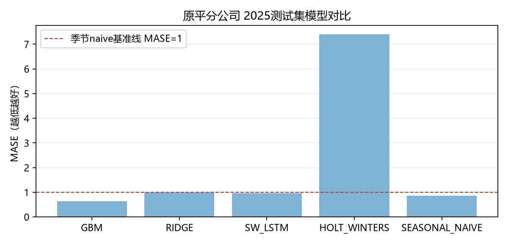

---

## 4. 2026 年 BAU 预测

### 4.1 年度汇总

| 组织  | 2025 可比实际 | 2026 可比预测 | 同比         | 2025 报表实际 | 2026 报表预测 | 同比     |
| --- | ---------:| ---------:| ----------:| ---------:| ---------:| ------:|
| 机辆  | 941,131   | 913,940   | **-2.89%** | 941,131   | 913,940   | -2.89% |
| 肃宁  | 25,934    | 25,404    | **-2.04%** | 22,913    | 22,383    | -2.31% |
| 原平  | 28,652    | 29,964    | **+4.58%** | 16,699    | 18,012    | +7.86% |

**解读**：

- 机辆：电力活动量总体平稳、柴油继续由 16 台降至 15 台，排放小幅下降 2.9%。
- 肃宁：热力与电力均小幅回落，排放下降 2.0%。
- 原平：2025 年电力偏低，2026 年回归后可比排放上升 4.6%；报表口径因 2025 供热系数已一次性下调，2026 同比 +7.9% 是“低基数”效应，不代表实际增排。

### 4.2 月度预测（可比口径 / 报表口径，tCO2e）

| 月份      | 机辆可比        | 机辆报表        | 肃宁可比       | 肃宁报表       | 原平可比       | 原平报表       |
| ------- | -----------:| -----------:| ----------:| ----------:| ----------:| ----------:|
| 2026-01 | 78,534      | 78,534      | 3,670      | 2,860      | 5,145      | 2,377      |
| 2026-02 | 77,120      | 77,120      | 3,402      | 2,720      | 4,847      | 2,513      |
| 2026-03 | 75,784      | 75,784      | 2,583      | 2,246      | 3,423      | 1,728      |
| 2026-04 | 75,226      | 75,226      | 1,695      | 1,695      | 2,143      | 1,376      |
| 2026-05 | 74,731      | 74,731      | 1,007      | 1,007      | 874        | 874        |
| 2026-06 | 74,038      | 74,038      | 1,114      | 1,114      | 792        | 792        |
| 2026-07 | 75,020      | 75,020      | 1,483      | 1,483      | 783        | 783        |
| 2026-08 | 74,377      | 74,377      | 1,616      | 1,616      | 820        | 820        |
| 2026-09 | 75,776      | 75,776      | 1,633      | 1,633      | 980        | 980        |
| 2026-10 | 77,093      | 77,093      | 1,719      | 1,719      | 866        | 866        |
| 2026-11 | 77,427      | 77,427      | 2,387      | 1,957      | 3,504      | 1,652      |
| 2026-12 | 78,814      | 78,814      | 3,096      | 2,333      | 5,787      | 3,251      |
| **合计**  | **913,940** | **913,940** | **25,404** | **22,383** | **29,964** | **18,012** |

> 区间：机辆 90% 名义区间约 62,418—91,601（1 月），全年区间见数据库/Excel；2025 实际覆盖率机辆 75%、肃宁 92%、原平 83%，区间偏保守，建议作为不确定性提示而非承诺。

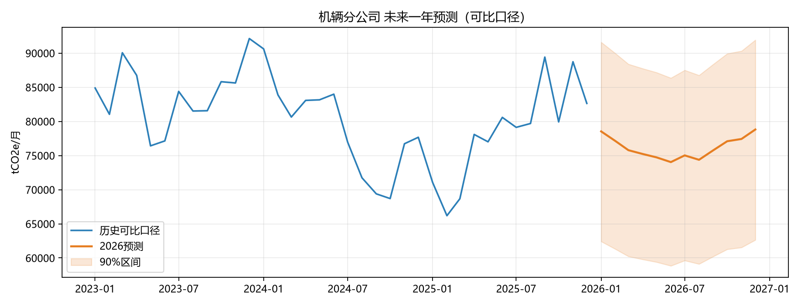
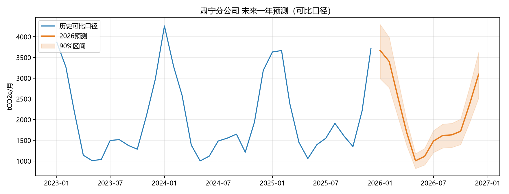
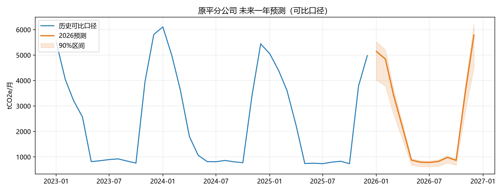

### 4.3 预测假设

1. 2026 年电力排放因子维持 0.5306 tCO2/MWh；
2. 肃宁/原平供热面积与 2025 年一致，报表折算系数维持 0.380/0.334；
3. 机辆内燃机车 2026 年 15 台，柴油按 2025 年同月结构分摊；
4. 无新线开通、无大规模运量转移、无极端天气；
5. 2026 年 11—12 月外部因子按气候态/最近值外推。

任一假设变化，应更新 `prediction_caliber_rule` / `prediction_policy_factor` 后重跑 `forecast`。

---

## 5. 异常筛查结论（V2）

V2 将复核级压缩为 8 条，另有 143 条“关注”级进入独立监控表；V1 的 19 条保留在 `prediction_anomaly_v1` 供对照。详见 [08_异常值识别算法V2改进说明.md](08_异常值识别算法V2改进说明.md)。

| 组织  | 复核级 | 典型问题                                        | 处置               |
| --- | ---:| ------------------------------------------- | ---------------- |
| 机辆  | 3   | 2023-01 天然气台阶；2024-10 柴油退役起点；2023-01 热力档位调整 | C2/C3 标记断点，保留原值  |
| 肃宁  | 2   | 2021-12 柴油连续漂移；2023-11 热力档位调整               | C2/C3 标记断点       |
| 原平  | 3   | 2021-01 电力漂移；2021-12 热力档位调整；2024-05 柴油尖峰    | C2/C3 标记断点，C1 保留 |

历史数据已核实且台账不可追溯，系统按“保留/标记”自动处置，不删除原始值。新增数据命中异常会进入 `pending`，必须人工复核后才能用于训练；COVID/春节可解释的短段异常进入监控，不占用复核队列。

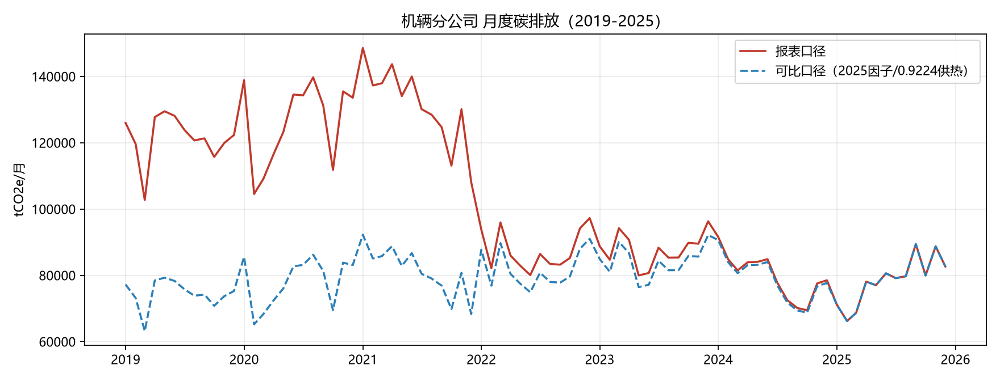
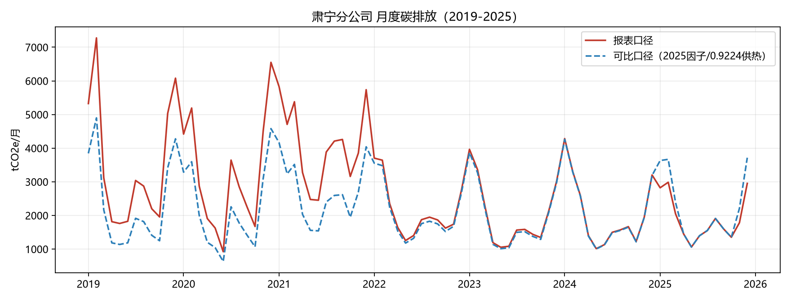
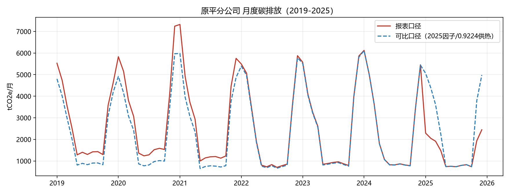

---

## 6. 限制与建议

### 6.1 限制

1. 84 个月样本，LSTM 仅 49—61 个窗口；机辆 MASE 1.09，不能宣称“显著优于基线”。
2. 2025 年是多重结构断点年（柴油退役、供热系数、电力因子），留出误差包含事件不可预见成分。
3. GRA 关联度整体偏弱，政策因子不足以支撑“政策减排效果”结论。
4. 区间覆盖率未完全达到 90%，且区间基于 2025 残差，存在一定事后校准成分；生产环境应改用滚动回测残差。
5. 2026 预测依赖 2025 因子/系数假设；政策或核算口径变化会使预测失效。

### 6.2 建议

1. 每月接入后先跑异常复核，再跑 `mode=auto` 训练；新增满 12 个月做全量。
2. 若平台能提供牵引电价、CEA 碳价、分车型周转量，建议重新做 GRA 与情景模块。
3. 对机辆，建议把“内燃机车台数”作为月度必填项，替代当前按年计划推算。
4. 对肃宁/原平，建议补充供热面积与计量热量，减少 HDD 分摊误差。
5. 将预测区间改为滚动回测残差的分位数，并每月更新覆盖率监控。

---

## 7. 复现与产物

| 产物        | 路径                                      |
| --------- | --------------------------------------- |
| 训练指标 JSON | `artifacts/reports/metrics_{org}.json`  |
| 选参明细      | `artifacts/reports/selection_{org}.csv` |
| 模型工件      | `artifacts/models/{model_id}/`          |
| 图表        | `artifacts/reports/*.png`               |
| Excel 汇总  | `artifacts/reports/碳排放预测结果汇总.xlsx`      |
| 数据库预测     | `prediction_forecast`                   |
| 数据库模型     | `prediction_model`                      |
| 数据库 GRA   | `prediction_gra_result`                 |
